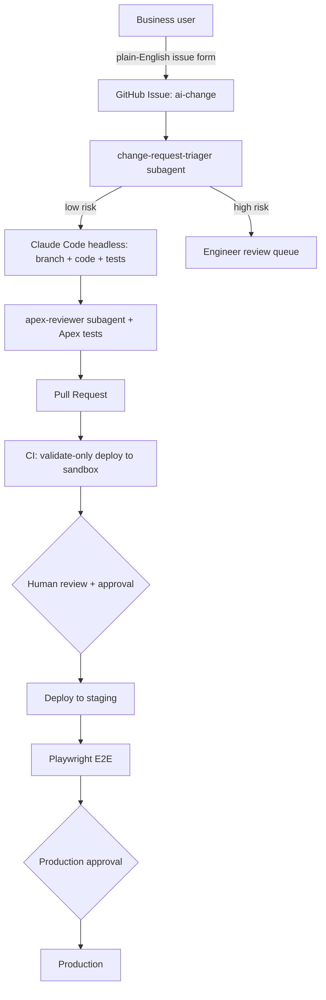

# Architecture

## Goal
Let non-technical teams propose Salesforce changes in plain English while engineering
quality, security and approvals stay intact.

## Flow

## Components
| Layer | Implementation |
|---|---|
| Agent environment | `.claude/` (agents, commands, hooks, settings), `CLAUDE.md`, `.mcp.json` |
| Guardrails | PreToolUse hook blocks non-sandbox deploys; scoped `--allowedTools` in CI |
| CI/CD | `.github/workflows/` (GitHub Actions); `azure-devops/` equivalent |
| Testing | Apex unit tests (local), Playwright E2E (staging) |
| Governance | Branch protection, GitHub Environments with required reviewers |

## Trust boundaries
- The agent only ever sees sandbox credentials. Production auth lives in a CI secret
  scoped to the `production` environment.
- The agent can open PRs but cannot merge or deploy.

## Extending to other stacks
The same pattern (issue form -> triage -> branch/PR -> review -> gated deploy) applies to
.NET/C# (`dotnet test`, Azure App Service), React (`npm test`, Static Web Apps) and
WordPress (WP-CLI, staging site). Swap the validate/deploy/test commands in the
workflows and `CLAUDE.md`.
