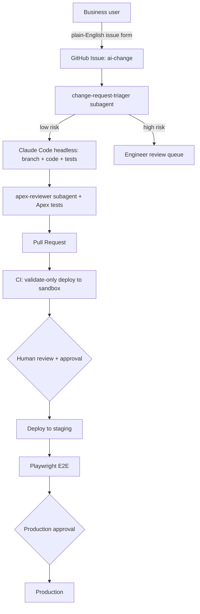
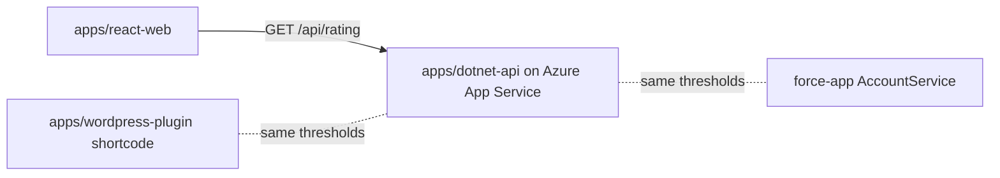

# Architecture

## Goal
Let non-technical teams propose Salesforce changes in plain English while engineering
quality, security and approvals stay intact.

## Flow

## Components
| Layer | Implementation |
|---|---|
| Agent environment | `.claude/` (agents, commands, hooks, settings), `CLAUDE.md`, `.mcp.json` |
| Guardrails | PreToolUse hook blocks non-sandbox deploys; scoped `--allowedTools` in CI |
| CI/CD | `.github/workflows/` (GitHub Actions); `azure-devops/` equivalent |
| Testing | Apex unit tests (local), Playwright E2E (staging) |
| Governance | Branch protection, GitHub Environments with required reviewers |

## Trust boundaries
- The agent only ever sees sandbox credentials. Production auth lives in a CI secret
  scoped to the `production` environment.
- The agent can open PRs but cannot merge or deploy.

## Multi-stack layout

| App | Stack | CI check | Deploy target |
|---|---|---|---|
| `force-app/` | Salesforce Apex/LWC | `sf project deploy validate` + Apex tests | sandbox -> staging -> production (gated) |
| `apps/dotnet-api/` | .NET 8 minimal API | `dotnet test` | Azure App Service `staging` slot, swap gated |
| `apps/react-web/` | React + Vite | Vitest + build | static hosting (add per environment) |
| `apps/wordpress-plugin/` | PHP plugin | `php -l` + unit test | WordPress staging site |

Each app has a path-filtered GitHub workflow, plus one Azure DevOps pipeline
(`azure-devops/azure-pipelines.yml`) with per-app stages and a gated production stage.
The rating thresholds are a deliberate cross-stack invariant, verified end to end by
`tests/e2e/cross-system.spec.ts`.
